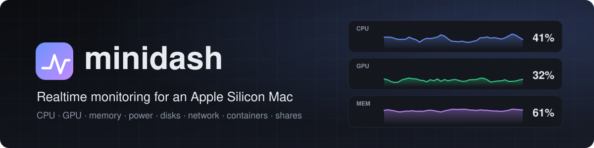
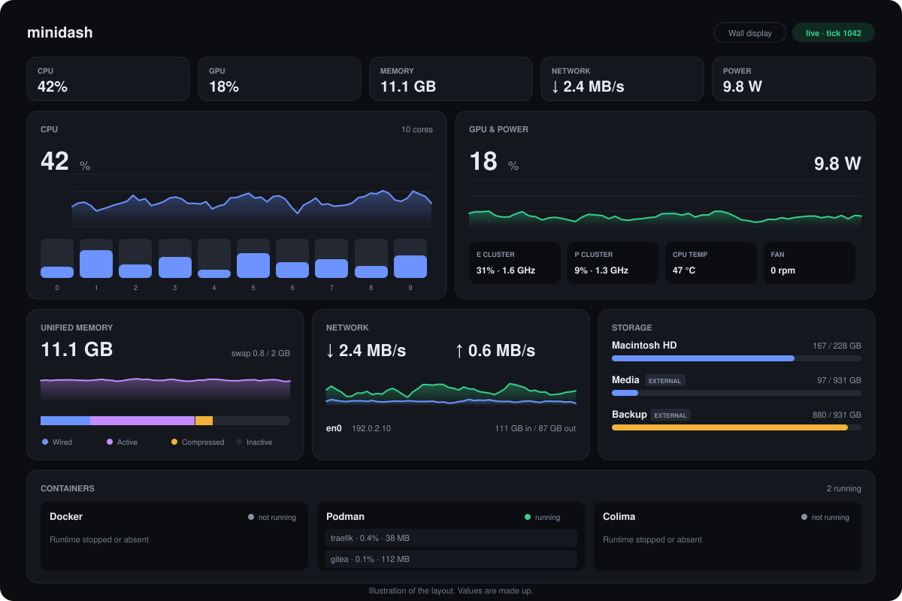
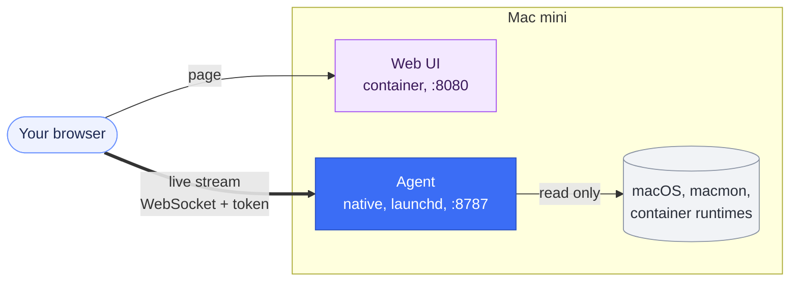

<div align="center">



<br>

**One page that shows what your Mac mini is doing, every second.**<br>
CPU, GPU, memory, power, disks, network, processes, containers and shares. Read-only, no root.

<br>

[](https://github.com/devdaviddr/minidash/actions/workflows/ci.yml)
[](LICENSE)


[Quick start](#quick-start) &nbsp;·&nbsp; [Architecture](docs/architecture.md) &nbsp;·&nbsp; [Docs](docs/README.md) &nbsp;·&nbsp; [Troubleshooting](docs/troubleshooting.md) &nbsp;·&nbsp; [Contributing](CONTRIBUTING.md)

</div>

<br>

<p align="center">
  
</p>

## Why minidash

- **Everything in one place.** Activity Monitor and a handful of CLIs give you point-in-time views. minidash puts CPU, GPU, unified memory, disks, network, containers and shares on a single live page you can leave open on a second screen or a wall display.
- **Built for Apple Silicon.** GPU, power draw, temperatures and fan speeds are included, with no root and no `sudo`.
- **Light on the machine it watches.** About 1.5% of one CPU core and 25 MB of memory in total, measured on the Mac mini with hundreds of processes and a dozen containers.
- **Safe by design.** Read-only, token required before any data is sent, and a hardened container for the page.
- **Fails gracefully.** One broken data source never blanks the page: each card reports its own state.

## What you get

| | |
| --- | --- |
| **CPU** | Total and per-core use, load average, 5 minute history |
| **GPU and power** | GPU use and clock, CPU clusters, system power in watts, temperatures, fan speeds |
| **Unified memory** | Used, wired, active, compressed and inactive memory, swap |
| **Storage** | Internal and external volumes with capacity bars, per-disk read and write throughput |
| **Network** | Per-interface throughput and totals for active interfaces |
| **Processes** | The busiest processes by CPU or memory, sortable |
| **Containers** | Docker, Podman and Colima side by side, with per-container CPU, memory and network |
| **Shares and accounts** | Mounted SMB and NFS shares, folders this Mac shares, connected clients and their accounts |

It also has light and dark themes that follow your system, and a wall-display mode (add `?wall` to the URL).

## How it works



A small Go **agent** runs natively on the Mac. Once a second it samples the machine and pushes one JSON snapshot to every connected browser over an authenticated WebSocket. A React **web UI**, served from a container, draws the stream. The agent is native because a container on macOS runs in a Linux VM and cannot see the Mac's real hardware ([why](docs/adr/0002-native-agent-containerised-ui.md)).

Both sides are checked against one JSON Schema, so they cannot drift apart. More diagrams and the reasoning: **[docs/architecture.md](docs/architecture.md)**.

## Quick start

You need an Apple Silicon Mac, [Homebrew](https://brew.sh), and a container tool (Docker, Colima or Podman).

**1. Get the code and dependencies**

```sh
brew install macmon go
git clone https://github.com/devdaviddr/minidash && cd minidash
```

**2. Install the agent.** It builds the binary, creates your access token and starts a launchd service that runs as you, not root.

```sh
deploy/install-agent.sh install --dry-run   # optional: see what it will do
deploy/install-agent.sh install
```

**3. Start the web UI**

```sh
docker compose -f deploy/compose.yaml up -d --build
```

**4. Open it.** Go to `http://<your-mac>:8080`, then paste the token from:

```sh
grep MINIDASH_TOKEN ~/.config/minidash/agent.env
```

The browser remembers the token after the first time. Upgrade, uninstall and verification steps are in **[docs/deploy.md](docs/deploy.md)**.

> [!WARNING]
> The dashboard speaks plain HTTP and `ws://` on your network, so the token and the metrics are not encrypted in transit. If your network has devices you do not trust, reach it over [Tailscale](https://tailscale.com) or put TLS in front. See [docs/security.md](docs/security.md).

## Requirements

| Needs | For |
| --- | --- |
| Apple Silicon Mac on macOS (developed on an M4 Mac mini, macOS 26) | everything |
| [`macmon`](https://github.com/vladkens/macmon) | GPU, power, temperatures and fans (the GPU card shows an install hint without it) |
| Docker, Colima or Podman | running the web UI container |
| Go 1.27 or newer | building the agent on the Mac (not needed if you copy a prebuilt binary) |

No root and no `sudo` are needed.

## Performance

Measured on an M4 Mac mini over 60 seconds with a browser connected, 693 processes and 14 containers:

| | CPU (share of one core) | Memory |
| --- | --- | --- |
| Agent | about 1.3% | about 25 MB |
| `macmon` (GPU and power sampler) | about 0.35% | small |
| **Total** | **about 1.65%** (budget: under 2%) | |

How it stays this light: [ADR 0006](docs/adr/0006-cpu-budget-and-throttling.md).

## Documentation

| Start here | Go deeper |
| --- | --- |
| [Deploying](docs/deploy.md) | [Architecture](docs/architecture.md) |
| [Configuration](docs/configuration.md) | [Collectors](docs/collectors.md) |
| [Operations](docs/operations.md) | [Stream protocol](docs/stream-protocol.md) |
| [Troubleshooting](docs/troubleshooting.md) | [Security](docs/security.md) |
| [Contributing](CONTRIBUTING.md) | [Development](docs/development.md) |
| [Changelog](CHANGELOG.md) | [Decision records](docs/adr/README.md) and the [spec](spec/0.1.0/spec.md) |

The full index is [docs/README.md](docs/README.md).

## Status

Spec 0.1.0 is approved and all eleven tasks are implemented and tested, and deployed to a real Mac mini. A GPU-load check and a visual review in a browser are still pending before the spec is marked `implemented`. See the [spec](spec/0.1.0/spec.md) and the [changelog](CHANGELOG.md).

<details>
<summary><strong>Known limits</strong></summary>

<br>

- GPU use is system-wide. macOS does not expose per-process GPU use without root.
- Connected-client account names can be blank, because macOS may serve SMB sessions as root.
- Only SMB and NFS shares are covered (AFP is out of scope).
- One shared access token, no per-user accounts, and no TLS built in.
- Built and tested on Apple Silicon only.

</details>

## Contributing

minidash is spec-driven and trunk-based: write the requirement first, work on short-lived branches, use Conventional Commits, and merge through CI. Read [CONTRIBUTING.md](CONTRIBUTING.md) to get started. For security issues, follow [SECURITY.md](SECURITY.md) instead of opening a public issue.

## License

[MIT](LICENSE)
