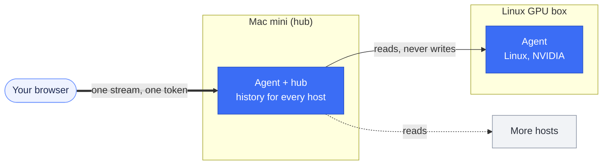

<div align="center">


<br>

**One page that shows what your machines are doing, every second.**<br>
CPU, GPU, memory, power, disks, network, processes, containers and shares. Read-only, no root.<br>
Runs on Apple Silicon Macs today. Linux hosts and several machines on one page are planned for 0.8.0 ([roadmap](#roadmap)).

<br>

[](https://github.com/devdaviddr/minidash/actions/workflows/ci.yml)
[](LICENSE)
[](https://github.com/devdaviddr/minidash/releases)


[Quick start](#quick-start) &nbsp;·&nbsp; [Roadmap](#roadmap) &nbsp;·&nbsp; [Architecture](docs/architecture.md) &nbsp;·&nbsp; [Docs](docs/README.md) &nbsp;·&nbsp; [Troubleshooting](docs/troubleshooting.md) &nbsp;·&nbsp; [Contributing](CONTRIBUTING.md)

</div>

<br>

<p align="center">
  
</p>

## Why minidash

- **Everything in one place.** Activity Monitor and a handful of CLIs give you point-in-time views. minidash puts CPU, GPU, unified memory, disks, network, containers and shares on a single live page you can leave open on a second screen or a wall display.
- **Built for Apple Silicon.** GPU, power draw, temperatures and fan speeds are included, with no root and no `sudo`.
- **Light on the machine it watches.** About 1.5% of one CPU core and 25 MB of memory in total, measured on the Mac mini with hundreds of processes and a dozen containers.
- **Safe by design.** Read-only, token required before any data is sent, and a hardened container for the page.
- **Fails gracefully.** One broken data source never blanks the page: each card reports its own state.

## What you get

| | |
| --- | --- |
| **CPU** | Total use, a hexagon "reactor" showing every core's load, load average, 5 minute history |
| **GPU and power** | GPU use and clock, CPU clusters, system power in watts, temperatures, fan speeds |
| **Unified memory** | Used, wired, active, compressed and inactive memory, swap |
| **Storage** | Internal and external volumes with capacity bars, per-disk read and write throughput |
| **Network** | Per-interface throughput and totals for active interfaces |
| **Processes** | The busiest processes by CPU or memory, sortable |
| **Containers** | Docker, Podman and Colima side by side, with per-container CPU, memory and network |
| **Shares and accounts** | Mounted SMB and NFS shares, folders this Mac shares, connected clients and their accounts |

Make it yours: a **System / Light / Dark** theme switch, and a **Customise** panel where you click a card to edit it, drag its edge to resize it, drag it to reorder, and show or hide cards and details. Every card adapts to the width you give it. Your layout is saved in the browser and can be exported and imported ([guide](docs/customising.md)). A wall-display mode (add `?wall` to the URL) hides the heavy cards for a big screen. A **Range** selector shows history from the live 5-minute view back to a configurable retention window (`MINIDASH_RETENTION`, up to 28 days).

## How it works


A small Go **agent** runs natively on the Mac. Once a second it samples the machine and pushes one JSON snapshot to every connected browser over an authenticated WebSocket. A React **web UI**, served from a container, draws the stream. The agent is native because a container on macOS runs in a Linux VM and cannot see the Mac's real hardware ([why](docs/adr/0002-native-agent-containerised-ui.md)).

Both sides are checked against one JSON Schema, so they cannot drift apart. Layout and theme live only in the browser: the agent stays read-only. More diagrams and the reasoning: **[docs/architecture.md](docs/architecture.md)**.

## Quick start

You need an Apple Silicon Mac, [Homebrew](https://brew.sh), and a container tool (Docker, Colima or Podman).

**1. Get the code and dependencies**

```sh
brew install macmon go
git clone https://github.com/devdaviddr/minidash && cd minidash
```

**2. Install the agent.** It builds the binary, creates your access token and starts a launchd service that runs as you, not root.

```sh
deploy/install-agent.sh install --dry-run   # optional: see what it will do
deploy/install-agent.sh install
```

**3. Start the web UI**

```sh
docker compose -f deploy/compose.yaml up -d --build
```

**4. Open it.** Go to `http://<your-mac>:8080`, then paste the token from:

```sh
grep MINIDASH_TOKEN ~/.config/minidash/agent.env
```

The browser remembers the token after the first time. Later, upgrade in one command from your dev machine with `deploy/upgrade.sh`. Uninstall and verification steps are in **[docs/deploy.md](docs/deploy.md)**.

> [!WARNING]
> On the LAN the dashboard speaks plain HTTP and `ws://`, so the token and metrics are not encrypted in transit. If the Mac is on a [Tailscale](https://tailscale.com) tailnet, run `deploy/tailscale-https.sh on` to publish it over HTTPS to the tailnet only, with certificates Tailscale manages ([how](docs/deploy.md#3-https-over-tailscale-optional-recommended)). See [docs/security.md](docs/security.md).

## Requirements

| Needs | For |
| --- | --- |
| Apple Silicon Mac on macOS (developed on an M4 Mac mini, macOS 26) | everything |
| [`macmon`](https://github.com/vladkens/macmon) | GPU, power, temperatures and fans (the GPU card shows an install hint without it) |
| Docker, Colima or Podman | running the web UI container |
| Go 1.27 or newer | building the agent on the Mac (not needed if you copy a prebuilt binary) |

No root and no `sudo` are needed.

## Performance

Measured on an M4 Mac mini over 60 seconds with a browser connected, 693 processes and 14 containers:

| | CPU (share of one core) | Memory |
| --- | --- | --- |
| Agent | about 1.3% | about 25 MB |
| `macmon` (GPU and power sampler) | about 0.35% | small |
| **Total** | **about 1.65%** (budget: under 2%) | |

The per-process GPU column (0.6.0) adds about 0.2% at its default 3 s interval ([figures](docs/collectors.md#per-process-gpu-spec-060-t-37-ac-35)).

How it stays this light: [ADR 0006](docs/adr/0006-cpu-budget-and-throttling.md).

## Documentation

| Start here | Go deeper |
| --- | --- |
| [Deploying](docs/deploy.md) | [Architecture](docs/architecture.md) |
| [Configuration](docs/configuration.md) | [Collectors](docs/collectors.md) |
| [Customising the dashboard](docs/customising.md) | [Stream protocol](docs/stream-protocol.md) |
| [Operations](docs/operations.md) | [Security](docs/security.md) |
| [Troubleshooting](docs/troubleshooting.md) | [Development](docs/development.md) |
| [Contributing](CONTRIBUTING.md) | [Decision records](docs/adr/README.md) |
| [Changelog](CHANGELOG.md) | The [spec](spec/0.7.0/spec.md) and [releasing](docs/releasing.md) |

The full index is [docs/README.md](docs/README.md).

## Status

Pre-1.0 and in daily use on a real Mac mini. Every release from 0.1.0 (the monitor) to 0.7.0 (log retention) is published on the [releases page](https://github.com/devdaviddr/minidash/releases), each with its own spec. Still checked by hand: GPU load under a real workload and a visual review in a browser. See the [released spec](spec/0.7.0/spec.md), the [draft for 0.8.0](spec/0.8.0/spec.md) and the [changelog](CHANGELOG.md).

<details>
<summary><strong>Known limits</strong></summary>

<br>

- Per-process GPU time is credited to the process macOS names as the GPU client. System services such as `runningboardd` and `WindowServer` can carry GPU time on an app's behalf, so an app can look idle while one of them looks busy. See [collectors](docs/collectors.md#processes).
- Connected-client account names can be blank, because macOS may serve SMB sessions as root.
- Only SMB and NFS shares are covered (AFP is out of scope).
- One shared access token, no per-user accounts, and no TLS built in.
- Built and tested on Apple Silicon only. Linux and multi-host support are planned for 0.8.0 ([roadmap](#roadmap)).

</details>

## Roadmap

minidash started as a monitor for one Mac mini. The next releases turn it into a monitor for a small fleet of machines, Macs and Linux boxes, on one page. The first extra host is a Linux GPU machine that serves local LLMs. None of this is released yet: the 0.8.0 [spec](spec/0.8.0/spec.md) is approved and in progress, with the Mac mini as the hub ([ADR 0017](docs/adr/0017-multi-host-hub.md)).

| Release | Plan |
| --- | --- |
| **0.8.0 multi-host** (in progress) | The same agent on Linux, with NVIDIA GPU use, VRAM, power and temperatures, and hwmon sensors. One agent acts as a **hub**: it reads the other agents' streams, keeps every host's history, and serves one page with one token. A **Fleet** card shows a tile per host; a host picker opens any host's full dashboard. A host that is asleep shows as down and nothing else breaks. Linux install as a systemd user service; one upgrade command for every host. |
| **0.9.0 Linux parity** (idea) | Per-process GPU and VRAM on NVIDIA, AMD and Intel GPUs, Samba and NFS exports, filling history gaps after a hub outage, and an optional probe for an LLM server (loaded model, tokens per second). |
| **0.10.0 Fleet insight** (idea) | Compare hosts on one chart; thresholds and alerts such as host down, disk nearly full or GPU hot. |
| Later (idea) | Windows hosts (its own release, after Linux), a layout per host, finding hosts on the tailnet. |



## Contributing

minidash is spec-driven and uses Git Flow: write the requirement first, branch from `develop`, use Conventional Commits, and merge through CI. Read [CONTRIBUTING.md](CONTRIBUTING.md) to get started. For security issues, follow [SECURITY.md](SECURITY.md) instead of opening a public issue.

## License

[MIT](LICENSE)
