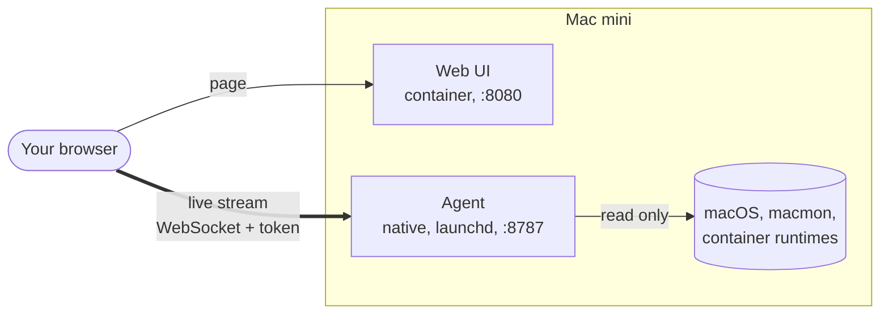

# minidash

[](https://github.com/devdaviddr/minidash/actions/workflows/ci.yml)
[](LICENSE)


A realtime dashboard for an Apple Silicon Mac (built for an M4 Mac mini). One page shows CPU, GPU, unified memory, power and temperatures, internal and external disks, network, processes, containers and network shares, updated every second.

It is read-only: it observes the machine and never changes it.

## What you get

| Card | Shows |
| --- | --- |
| **CPU** | Total and per-core utilisation, load average, 5 minute history |
| **GPU & power** | GPU use and clock, CPU clusters, system power in watts, temperatures, fan speeds |
| **Unified memory** | Used, wired, active, compressed and inactive memory, swap, 5 minute history |
| **Storage** | Internal and external volumes with capacity bars, per-disk read/write throughput |
| **Network** | Per-interface throughput and totals for active interfaces |
| **Processes** | Busiest processes by CPU or memory, sortable |
| **Containers** | Docker, Podman and Colima side by side, with per-container CPU, memory and network |
| **Shares & accounts** | Mounted SMB/NFS shares, folders this Mac shares, connected clients and accounts |

Also: light and dark themes, a wall-display mode (`?wall`), and per-card failure isolation, so one broken data source never blanks the page.

## How it works



A small Go **agent** runs natively on the Mac (a container on macOS runs in a Linux VM and cannot see the Mac's real hardware). Once a second it samples the machine and pushes one JSON snapshot to every connected browser over an authenticated WebSocket. A React **web UI**, served from a container, draws the stream. Both sides are checked against one JSON Schema, so they cannot drift apart.

More diagrams and the reasoning: [docs/architecture.md](docs/architecture.md).

## Quick start

On the Mac you want to monitor:

```sh
brew install macmon go
git clone https://github.com/devdaviddr/minidash && cd minidash

deploy/install-agent.sh install          # builds, installs the launchd service, creates your token
docker compose -f deploy/compose.yaml up -d --build    # the web UI (Docker, Colima or Podman)

grep MINIDASH_TOKEN ~/.config/minidash/agent.env       # your access token
```

Open `http://<your-mac>:8080`, paste the token once, and you are in.

Check what the installer will do first with `deploy/install-agent.sh install --dry-run`. Full steps, verification and upgrade: [docs/deploy.md](docs/deploy.md).

> **Network note.** The dashboard speaks plain HTTP and `ws://` on your LAN. Use it over [Tailscale](https://tailscale.com) or behind TLS if your network has untrusted devices. Details: [docs/security.md](docs/security.md).

## Requirements
- An Apple Silicon Mac running macOS (developed and tested on an M4 Mac mini, macOS 26).
- [`macmon`](https://github.com/vladkens/macmon) for GPU, power and temperatures (the GPU card shows an install hint without it).
- Docker-compatible tooling (Docker, Colima or Podman) to run the UI container. Go 1.27+ only if you build the agent on the Mac.
- No root, no sudo. The agent runs as your user.

## Cost
About 1.5% of one CPU core in total (agent plus `macmon`) and about 25 MB of memory, measured on the Mac mini with several hundred processes and a dozen containers. The budget is part of the spec; see [ADR 0006](docs/adr/0006-cpu-budget-and-throttling.md).

## Documentation
Start at the [documentation index](docs/README.md): [architecture](docs/architecture.md), [deploying](docs/deploy.md), [configuration](docs/configuration.md), [operations](docs/operations.md), [troubleshooting](docs/troubleshooting.md), [security](docs/security.md), [collectors](docs/collectors.md), [stream protocol](docs/stream-protocol.md), [development](docs/development.md) and the [decision records](docs/adr/README.md).

## Status
Spec 1.0.0 is approved and all eleven tasks are implemented and tested. Still pending: a GPU-load check and a visual review in a browser before the spec is marked `implemented`. See [spec/1.0.0](spec/1.0.0/spec.md) and [CHANGELOG.md](CHANGELOG.md).

## Known limits
- GPU use is system-wide; macOS does not expose per-process GPU use without root.
- Connected-client account names can be blank, because macOS may serve SMB sessions as root.
- Only SMB and NFS shares are covered (AFP is out of scope).
- One shared access token, no per-user accounts, no TLS built in.

## Contributing
Read [CONTRIBUTING.md](CONTRIBUTING.md). The project is spec-driven and trunk-based: specs first, short-lived branches, Conventional Commits, CI-gated merges. Security issues: [SECURITY.md](SECURITY.md).

## License
[MIT](LICENSE)
