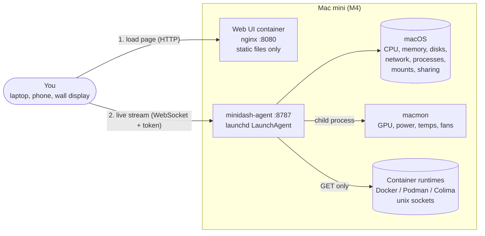
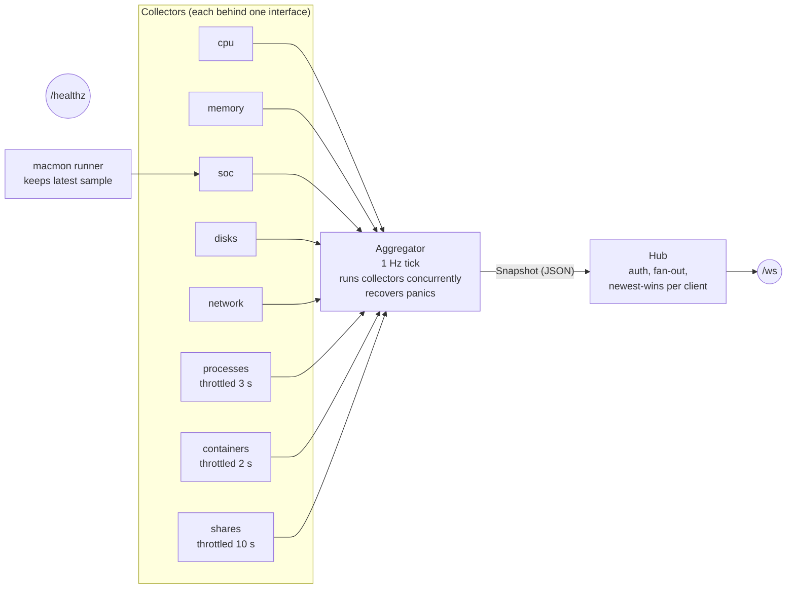
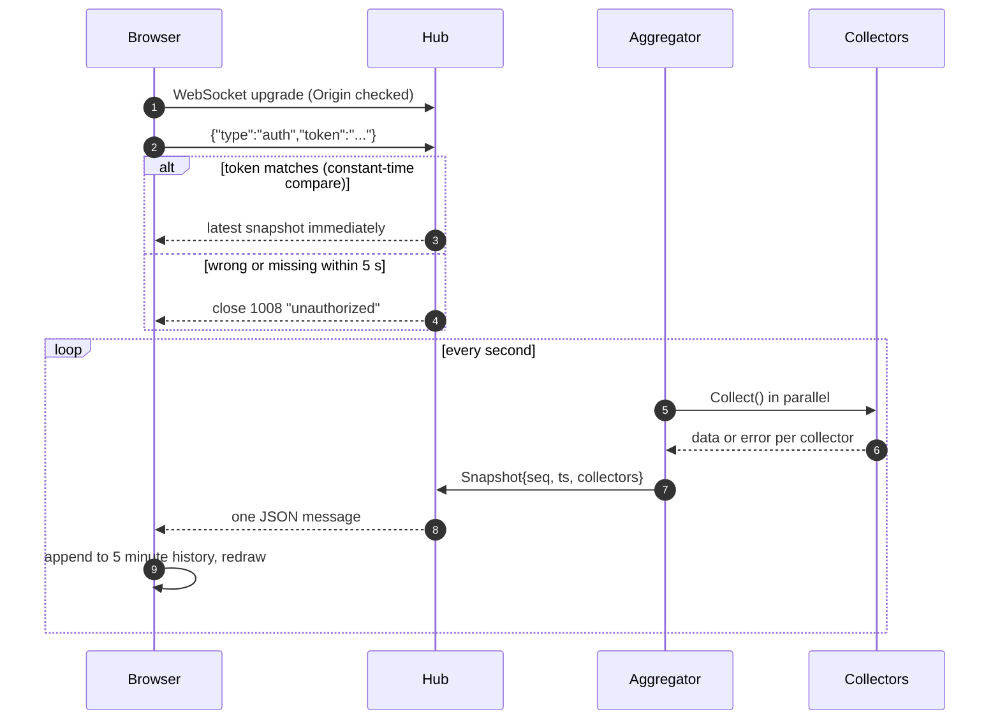
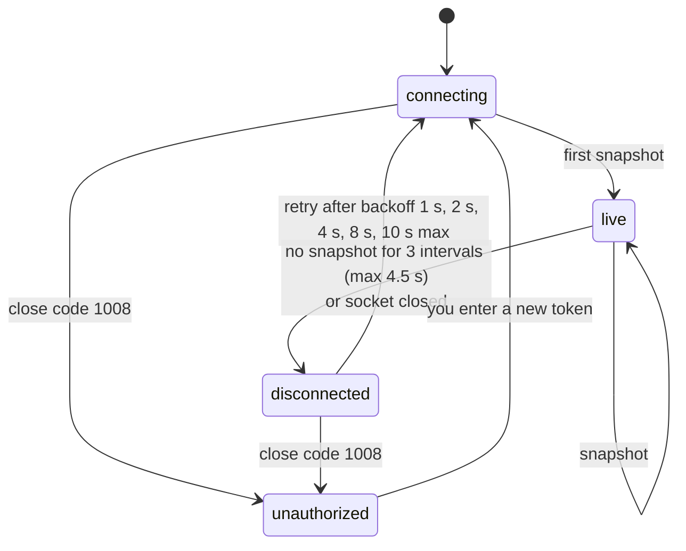
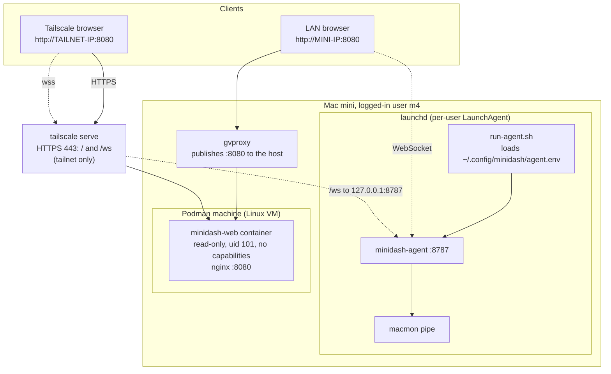
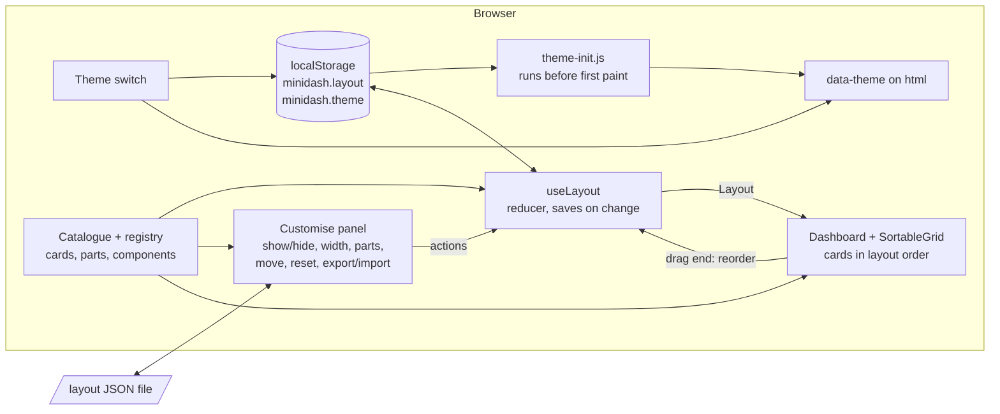
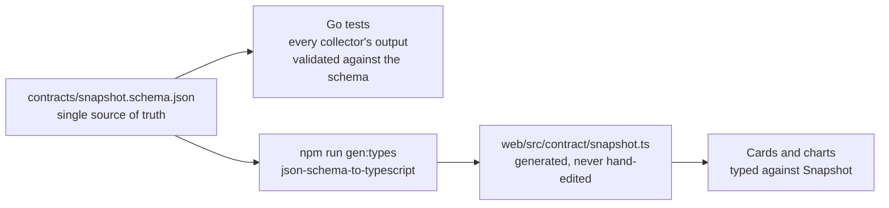

# Architecture

minidash has two deployable parts and one shared contract:

- **Agent** (`agent/`, Go): runs natively on the Mac mini, samples the machine once a second and pushes snapshots over an authenticated WebSocket.
- **Web UI** (`web/`, React + TypeScript): a static single-page app, served from a container, that draws the stream.
- **Contract** (`contracts/snapshot.schema.json`): the JSON Schema both sides are checked against.

Why the agent is native and only the UI is containerised is explained in [ADR 0002](adr/0002-native-agent-containerised-ui.md).

## System context



The browser loads the page from the container, then opens its own WebSocket straight to the agent. The container never sees metrics and never holds the token.

## Inside the agent



Key properties:

- **Fail independently.** A collector that errors or panics becomes `{"ok": false, "error": "..."}` in the snapshot. The other collectors and the stream are unaffected.
- **One tick, one message.** Every second the aggregator runs all collectors in parallel and emits a single snapshot. `seq` increases by one per tick, so a gap means dropped ticks.
- **Throttled collectors repeat their last result** between refreshes. The stream still ticks at 1 Hz. See [ADR 0006](adr/0006-cpu-budget-and-throttling.md).
- **Read-only.** Nothing in the agent starts, stops or changes a process, container, mount or setting. The container client only issues `GET`.

### Collectors at a glance

| Collector | Data source | Refresh | Details |
| --- | --- | --- | --- |
| `cpu` | gopsutil (CPU time deltas) | 1 s | [collectors.md](collectors.md#cpu-budget-nfr-under-2-of-one-core) |
| `memory` | gopsutil + `vm_stat` (cached 5 s) | 1 s | [collectors.md](collectors.md) |
| `soc` | `macmon pipe` child process | 2 s (configurable) | [ADR 0003](adr/0003-macmon-for-gpu-and-power.md) |
| `disks` | gopsutil + `diskutil` (cached per device) | 1 s | [collectors.md](collectors.md#disks) |
| `network` | kernel `ifmib` sysctl | 1 s | [ADR 0005](adr/0005-kernel-counters-for-network.md) |
| `processes` | gopsutil process table | 3 s | [collectors.md](collectors.md#processes) |
| `containers` | Docker Engine API over unix sockets | 2 s | [collectors.md](collectors.md#containers) |
| `shares` | `mount`, `sharing -l`, `netstat`, `ps` | 10 s | [collectors.md](collectors.md#shares) |

## One tick, end to end



A slow client never slows the others: each client has a one-slot buffer that keeps only the newest snapshot. See [stream-protocol.md](stream-protocol.md) for the wire format.

## Browser connection states

The UI shows one of four states and recovers on its own.



`unauthorized` stops retrying, so a wrong token does not hammer the agent. The backoff resets as soon as a snapshot arrives.

## Deployment on the Mac mini



- The agent runs as **you**, not root, so it can reach your per-user container sockets. `KeepAlive` restarts it if it dies (observed: about one second).
- The token lives in a mode-600 env file, never in the plist or the container.
- The container cannot see host metrics (it runs in a Linux VM), which is why it only serves static files.

The HTTPS path is optional: `deploy/tailscale-https.sh on` makes Tailscale terminate TLS (certificates are Tailscale's job) and forward to the local ports, and the page then connects with `wss://`. See [ADR 0012](adr/0012-https-through-tailscale-serve.md). Install steps are in [deploy.md](deploy.md); settings are in [configuration.md](configuration.md).

## Web UI: layout and theme (spec 0.2.0)

Layout and theme are browser state. The agent is not involved.



- The **catalogue** (`web/src/layout/catalogue.ts`) lists every card and every hideable detail. The **registry** maps each card to its component. Validation, the panel and the grid all read from them, and a test checks the catalogue against the real components.
- The **layout model** is pure code: a validator that refuses wrong structure and repairs what a newer or older version could produce, and a reducer for the actions. It never touches the network.
- **Cards respond to their own width.** `Card` is a size container, and everything inside uses container variants (`@xl:`, `@3xl:`) so a one-column and a full-width card each fit. The page grid is 1 column below 768 px, 2 from 768 px and 4 from 1024 px. See [ADR 0010](adr/0010-container-queries-and-width-resize.md).
- **Selection and resizing.** The app holds a transient `selectedId` (never stored). Clicking a card while Customise is open selects it and the sidebar shows that card. A grip on each card's edge resizes in whole columns through a pure `spanFromPointer` function, and is also a keyboard slider.
- **Themes** use a `data-theme` attribute and CSS variables. System means no attribute, so CSS follows the OS. `theme-init.js` is a separate same-origin file because the container's CSP forbids inline scripts. See [ADR 0009](adr/0009-browser-side-layout-and-theme.md) and [customising.md](customising.md).

## The contract



Because both sides are checked against one schema, the agent and the UI cannot drift apart silently: a change that breaks the shape fails a Go test or the TypeScript build. Changes are additive within a major spec version ([development.md](development.md#changing-the-contract)).

## Repository layout

```text
agent/                  Go module (the agent)
  cmd/minidash-agent/   main: wires collectors, hub and HTTP
  internal/
    snapshot/           Snapshot type, Collector interface, aggregator, throttle
    hub/                WebSocket auth and fan-out
    macmon/             macmon subprocess runner and parser
    config/             environment settings
    collect/<name>/     one package per collector, each with a fake-friendly OS interface
    testutil/           schema-contract assertion shared by collector tests
web/                    React + Vite + Tailwind app (and its Dockerfile, nginx config)
  src/layout/           catalogue, registry, layout model, drag-and-drop and resize helpers
  src/components/       cards, dashboard grid, customise panel, theme switch
contracts/              JSON Schema for the wire format
deploy/                 launchd installer, run script, compose file
docs/                   this documentation, ADRs
spec/<version>/         spec, plan and tasks (spec-driven development)
tools/                  spec helper, probe tool
.claude/, .githooks/    rules and hooks that enforce the workflow
```
