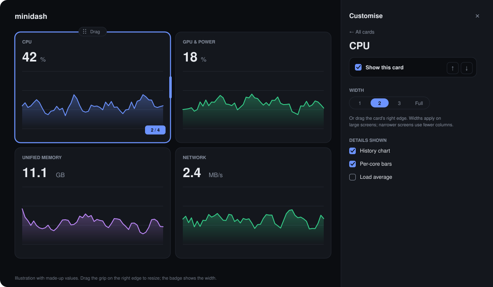

# Customising the dashboard

Everything here is in the browser. Nothing is sent to the agent, and nothing about your layout leaves your machine.

## Themes
The **System / Light / Dark** switch is in the header. System (the default) follows your operating system and changes live when it does. Your choice is remembered in this browser and applied before the page paints, so there is no flash of the wrong theme. Charts recolour at once.

Both themes meet WCAG AA contrast (4.5:1) for text. A test reads the real colour tokens and fails the build if a pair drops below that.

## The customise panel
Click **Customise** in the header. A panel opens on the right and the dashboard shifts over so you can watch it change as you work. Press **Escape** or the close button to finish; focus returns to the Customise button.

<p align="center">
  
</p>

The panel has two views.

**Overview** (nothing selected): the summary strip, then every card in display order with a checkbox to show or hide it, a button to select it, and move earlier/later buttons. The save, export, import and reset controls are at the bottom.

**Card view** (a card selected): just that card. You get its show/hide checkbox, move buttons, **Width**, and **Details shown**. Use **← All cards** to go back.

### Selecting a card
While Customise is open, **click a card** to select it. It is outlined and the sidebar switches to its card view. Click another card to switch. You can also choose a card from the overview list, which works without a mouse. Press **Escape** to deselect (a second Escape closes the panel), or use **← All cards**. Selecting never changes your layout, and nothing is selected when Customise is closed.

### Resizing
Each card shows a grip on its right edge while Customise is open on a large screen (the grid has four columns from 1024 px). Drag the grip left or right and the card snaps to **1, 2, 3 or 4 columns** with a live "2 / 4" badge. **Escape** cancels and puts the width back. The grip is also a keyboard slider: Tab to it, then **Left/Right** change the width by one column, **Home** and **End** jump to 1 and 4. Screen readers hear it as a slider with its value ("2 of 4 columns"). You can also pick a width in the card view.

Only the width changes. A card's height always follows its content, so nothing is clipped.

### Reordering
While the panel is open, every card shows a **Drag** handle at its top edge.

- **Mouse or touch:** drag the handle. (Touch needs a short press first, so scrolling still works.)
- **Keyboard:** Tab to a handle, press **Space** to pick the card up, move it with the **arrow keys**, and press **Space** to drop it. **Escape** cancels. Screen readers hear each step announced.
- **Buttons:** **Move … earlier** and **Move … later** shift a card by one place among the cards you can see. Hidden cards never absorb a step. This is the simplest route if dragging is awkward.

### Details you can hide
| Card | Details |
| --- | --- |
| Summary strip | CPU, GPU, Memory, Network, Power |
| CPU | History chart, Per-core bars, Load average |
| GPU & power | History chart, CPU clusters, Temperatures, Fans |
| Unified memory | History chart, Breakdown bar, Swap |
| Network | History chart, Interface list |
| Storage | I/O chart, Per-volume throughput |
| Shares & accounts | Mounted on this Mac, Shared by this Mac, Connected clients |
| Containers | Runtimes that are not running |
| Processes | Owner column, GPU note |

Hiding a detail removes only that detail. The rest of the card, and every other card, is untouched.

## Responsive layout
The page adapts at two levels.

**The screen.** The grid is one column below 768 px (phones), two columns from 768 px (tablets) and four columns from 1024 px. On two columns a card of width 2, 3 or 4 takes the whole row and a width-1 card takes half. On one column everything takes the row. Widths only matter on four columns.

**The card itself.** Everything inside a card responds to the width that card actually has, not to the screen, because the same screen shows narrow and wide cards side by side. For example:

| Card | Narrow (1 column) | Wide |
| --- | --- | --- |
| CPU | shorter core bars, load average wraps under the total | taller core bars |
| GPU & power | tiles in one or two columns | four tiles across |
| Memory | total and swap stacked | total and swap side by side |
| Network | rates wrap, cumulative bytes hidden | cumulative bytes shown |
| Storage | one volume per row | volumes in two columns |
| Shares & accounts | three sections stacked | three sections side by side |
| Containers | one runtime per row | two, then three runtimes across |
| Processes | process name and CPU/memory only | PID, then owner columns appear |

## Saving, exporting and importing
Your layout is saved automatically in this browser (`localStorage`, key `minidash.layout`; the theme is `minidash.theme`). Clearing the site's data resets both. If the browser will not let minidash store anything, the panel says so and the layout lasts until you close the page.

**Export layout** downloads `minidash-layout.json`. **Import layout…** reads one back. Import checks the file first:

- A file that is not valid JSON, is not a minidash layout, or comes from a newer minidash is **refused with a message, and your layout is not changed**.
- Things a different version could legitimately produce are repaired, and the panel tells you what it did: unknown cards or details are ignored, a card missing from the file is added with its defaults (so cards from a newer minidash appear automatically), and an unusable width falls back to the card's default.

### File format
```json
{
  "version": 1,
  "summary": { "visible": true, "hidden": ["power"] },
  "cards": [
    { "id": "gpu", "visible": true, "span": 2, "hidden": [] },
    { "id": "cpu", "visible": true, "span": 4, "hidden": ["cores"] }
  ]
}
```
The order of `cards` is the display order. `span` is 1, 2, 3 or 4 (files from 1.1.0, which used only 1, 2 and 4, import unchanged). Card ids: `cpu`, `gpu`, `memory`, `network`, `storage`, `shares`, `containers`, `processes`. The theme is not part of the file, because it often differs per device.

## Wall display
`?wall` in the URL, or the **Wall display** button, hides the process table and the shares card and enlarges the type. It is applied on top of your layout and never changes it, so turning it off brings those cards back.

## Ideas
- **Wall screen:** hide Processes and Shares, drag CPU and Network to full width, and hide the per-core bars.
- **Phone:** hide the summary strip, history charts and Containers, and keep CPU, Memory and Storage.
- **Quiet server:** hide Fans, Temperatures and the process note.

## Accessibility
Every control in the panel has an accessible name and a visible focus style, selecting, resizing and drag and drop each have a full keyboard path, the live region announces drags, the resize grip is a labelled slider, and animations stop under your system's reduced-motion setting.

## Limits
- One layout per browser. There are no named layouts and no sync between devices (use export and import).
- Cards flow in a grid. You choose order and width, not exact positions or height.
- Colours are not customisable beyond Light and Dark.
