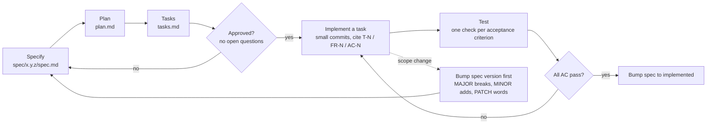
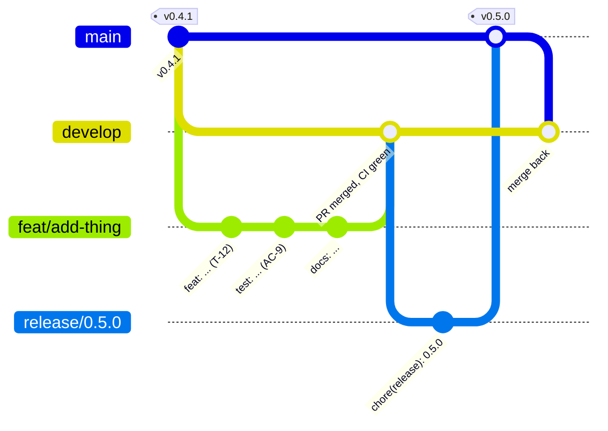

# Development

## Prerequisites
| Tool | For | Install |
| --- | --- | --- |
| Go (see `agent/go.mod`) | the agent | `brew install go` |
| Node 22+ and npm | the web app | `brew install node` |
| `golangci-lint` | `make check` | `brew install golangci-lint` |
| `macmon` | GPU/power data when running locally | `brew install macmon` |
| macOS on Apple Silicon | the real-host tests and live data | Tests that need macOS skip themselves elsewhere, and CI runs on Linux. |

## First run
```sh
git clone https://github.com/devdaviddr/minidash && cd minidash
make setup                                   # installs git hooks, runs npm ci

# terminal 1: the agent
MINIDASH_TOKEN=dev MINIDASH_ORIGINS=localhost:5173 go run ./agent/cmd/minidash-agent

# terminal 2: the UI with hot reload (http://localhost:5173, token "dev")
cd web && npm run dev

# no browser needed: print one snapshot
MINIDASH_TOKEN=dev node tools/probe.mjs ws://127.0.0.1:8787/ws 1 cpu
```
`MINIDASH_ORIGINS=localhost:5173` lets the Vite dev server open the WebSocket.

## Make targets
| Target | Does |
| --- | --- |
| `make setup` | `git config core.hooksPath .githooks` and `npm ci` in `web/` |
| `make check` | gofmt, `go vet`, `go test -race`, `golangci-lint`, oxlint, `tsc -b`, web tests |
| `make build` | `bin/minidash-agent` and `web/dist/` |

## How work flows
minidash is spec-driven: the contract is written and approved before code. Git Flow keeps `main` equal to the latest release while work collects on `develop` ([ADR 0013](adr/0013-git-flow-and-merge-commits.md)).



- `spec/<version>/` holds `spec.md` (what and why), `plan.md` (how) and `tasks.md` (do). The highest version is current; older ones are frozen history.
- `python3 -I tools/sdd/scripts/spec_tool.py list|show|bump` manages versions.
- A hook blocks writing application code until the spec is `approved`.



### Git rules (enforced by hooks and branch protection)
- Branch from current `develop` as `type/short-slug` (`feat/`, `fix/`, `docs/`, `chore/`, `ci/`, `perf/`, `refactor/`, `test/`). Do not stack branches. Delete after merge.
- `main` holds released code only. Release branches (`release/x.y.z`) are cut from `develop` and hotfix branches (`hotfix/x.y.z`) from `main`; both merge into `main`, are tagged, and merge back into `develop`. See [releasing.md](releasing.md).
- Conventional Commits, 72 characters max for the first line: `feat(agent): add thing`. The body says why and cites `T-N`, `FR-N`, `AC-N`.
- One logical change per commit. Branch commits are kept by the merge commit, so make each one tidy and meaningful. Never `--no-verify`, never force-push shared branches.
- The `commit-msg`, `pre-commit` and `pre-push` hooks in `.githooks/` block bad messages, commits on `main` or `develop`, edits to frozen spec versions, obvious secrets and pushes to `main`.
- Open a PR into `develop`. CI must pass (`governance`, `agent`, `web`). Every PR is merged with a **merge commit** (squash and rebase are off). The title is a Conventional Commit and becomes the release note; type and size labels are added automatically. PRs into `main` come only from `release/*` or `hotfix/*`. See [ADR 0013](adr/0013-git-flow-and-merge-commits.md), [ADR 0011](adr/0011-squash-merge-and-labelled-releases.md) for labels and notes, and [releasing.md](releasing.md).

## Testing strategy
| Layer | What | Where |
| --- | --- | --- |
| Unit, with fakes | Each collector sits behind an `OS`-style interface; tests feed fixed readings | `agent/internal/collect/*/…_test.go` |
| Parsers on recorded fixtures | `macmon` JSON, `diskutil` plist, `mount`, `sharing -l`, `netstat`; all fixtures use invented or sanitised data | `testdata/`, inline constants |
| Contract | Every collector's output, through the aggregator, validated against the JSON Schema | `testutil.AssertMatchesContract` |
| Real-host smoke | Each collector run against the machine running the tests; skipped off macOS where needed | `TestRealHostSane` |
| Cross-checks | Kernel network counters against `netstat -ib`; top memory process against `ps` | network and processes tests |
| Protocol | Auth, wrong token, slow client, reconnect and backoff, stall detection | `hub_test.go`, `stream.test.ts` |
| Deploy scripts | `tailscale-https.sh` and `upgrade.sh` against stubbed `tailscale`, `ssh`, `rsync`, `go` and `node`: success, each failure, dry run, no token leaks | `deploy/tests/*.test.sh` (run in CI) |
| Claude hooks | `guard-bash.sh` fed PreToolUse JSON with a stubbed `gh`: PRs into `develop` allowed, into `main` or with no base blocked, force pushes blocked | `.claude/hooks/tests/*.test.sh` (run in CI) |
| UI components | Every card rendered from a fixture, healthy and degraded (jsdom) | `web/src/components/*.test.tsx` |
| Manual, on the Mac mini | GPU load, plugging a drive, starting Colima, a client connecting | [deploy.md](deploy.md#manual-acceptance-checks-need-the-real-mini) |

Rules: one test per acceptance criterion; no test may depend on the host's real load; keep real-data fixtures free of hostnames, IPs, share names and account names.

## Adding a collector
1. **Spec.** Add the requirement (`FR-N`), acceptance criterion (`AC-N`) and a task, and bump the spec if scope grows.
2. **Contract.** In `contracts/snapshot.schema.json` add `$defs/<name>Data`, `$defs/<name>Result` and a `properties.collectors.<name>` entry. Use `additionalProperties: false` and units in descriptions.
3. **Collector.** Create `agent/internal/collect/<name>/`:
   ```go
   // OS abstracts the host so tests can supply fixed readings.
   type OS interface { /* the few calls you need */ }

   type Collector struct{ os OS }

   func New() *Collector            { return NewWith(realOS{}) }
   func NewWith(o OS) *Collector    { return &Collector{os: o} }
   func (*Collector) Name() string  { return "<name>" }
   func (c *Collector) Collect(ctx context.Context) (any, error) { /* read-only */ }
   ```
   Return a typed struct whose JSON tags match the schema. Return an error to mark just this collector failed.
4. **Tests.** A fake `OS`, the behaviour you rely on, a parser test on a sanitised fixture if you parse command output, `testutil.AssertMatchesContract(t, c)`, and a real-host smoke test.
5. **Wire it** in `agent/cmd/minidash-agent/main.go`. If one call costs more than about 5 ms or forks a process, wrap it: `snapshot.Throttle(c, 3*time.Second)`.
6. **Measure CPU.** Run the agent for a minute and compare `ps -o time=` before and after. The whole monitor must stay under 2% of a core.
7. **UI.** `cd web && npm run gen:types`, add a card in `web/src/components/`, add it to `App.tsx`, and add a fixture entry plus a render test.
8. **Docs.** Add a section to [collectors.md](collectors.md) (source, units, refresh, failure modes) and tick the task in `spec/<version>/tasks.md`.

Collectors must be read-only. Do not collect command-line arguments, credentials or file contents.

### Adding a card to the UI
A card that shows an existing collector's data needs no agent change:

1. Add it to `web/src/layout/catalogue.ts`: `id`, `title`, `defaultSpan` and its hideable `parts`.
2. Build the component in `web/src/components/`. Take `{ history, hidden }` (`CardProps`) and wrap each hideable piece in `<Part id="..." hidden={hidden}>`.
3. Add it to the `COMPONENTS` record in `web/src/layout/registry.tsx`. The record is typed over the catalogue ids, so forgetting this fails to compile.
4. Add data for it to `web/src/test/fixture.ts`.

The test `Dashboard.test.tsx` then checks that every declared part renders and disappears when hidden. Existing users get the new card automatically (a missing card is appended with its defaults). Use theme tokens only: a test fails on fixed palette colours, and another on text pairs below 4.5:1 contrast. Lay out the inside of a card with **container variants** (`@xl:`, `@3xl:`, ...) and never viewport ones (`md:`, `lg:`): a test enforces both, and also that every card uses at least one container variant. Card content is about 17 rem wide at one column, 36 rem at two, 57 rem at three and 77 rem at four on a 1280 px screen, so `@2xs`, `@xl` and `@3xl` are the useful breakpoints.

## Changing the contract
- Additive changes (a new optional field or a new collector) are a MINOR spec bump.
- Removing, renaming or retyping a field breaks the UI and is a MAJOR bump.
- After editing the schema run `npm run gen:types` in `web/` and commit the regenerated `src/contract/snapshot.ts`. Never edit that file by hand.

## Conventions
- **Go:** small functions, early returns, no commented-out code, doc comment on every exported name, errors wrapped with context. `gofmt`, `go vet` and `golangci-lint` must be clean.
- **TypeScript:** strict mode, no `any`, theme colours only (`bg-surface`, `text-fg`, `border-line`, `bg-accent`...) so light and dark both work. A test forbids fixed palette colours in the token form; keep other components to the same rule.
- **Accessibility:** keyboard operable, visible focus, labels on form controls, `aria-sort` on sortable columns, reduced motion respected.
- **Comments** explain why, not what.
- **Docs** change in the same commit as the behaviour they describe.

## CI
`.github/workflows/ci.yml` runs three jobs on every PR and on pushes to `main`:

| Job | Checks |
| --- | --- |
| `governance` | the spec tool runs; an approved spec has no unresolved `[NEEDS INPUT]` markers; PR titles are Conventional Commits; the PR labelling logic and the deploy script tests pass |
| `agent` | `go vet`, `go test` |
| `web` | `npm ci`, oxlint, vitest, production build |

Two more workflows run outside CI: `pr-labels` labels each PR from its title and size, and `release` publishes a GitHub Release when a `vX.Y.Z` tag is pushed ([releasing.md](releasing.md)). Dependabot proposes weekly updates for Go modules, npm packages and GitHub Actions.
