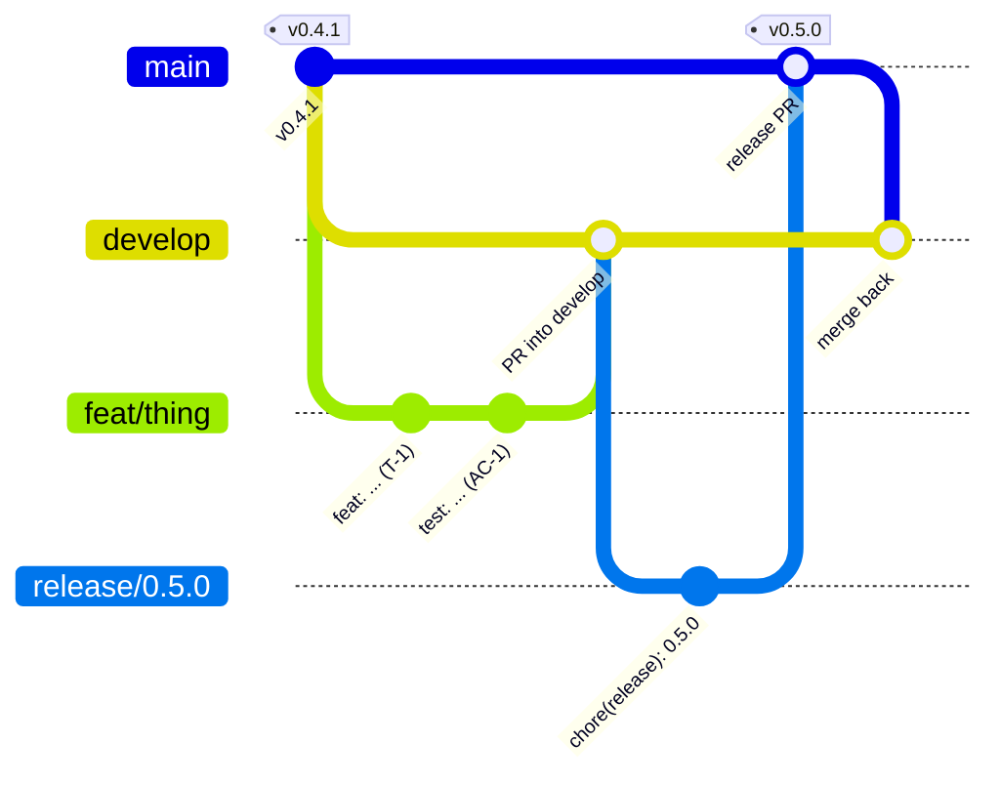

# Releasing

A release is a deliberate act on a tag. It publishes a GitHub Release with notes grouped by type, the agent for Apple Silicon, the built web UI and checksums. Branching follows Git Flow ([ADR 0013](adr/0013-git-flow-and-merge-commits.md)): work collects on `develop`, and `main` only ever receives release and hotfix branches.

## Versions
The product version is the **spec version**: `spec/0.5.0/` is release `v0.5.0`. Tags are `vMAJOR.MINOR.PATCH`.

minidash stays below 1.0.0 until the owner declares it stable. Until then:
- each release is a **MINOR** bump (`v0.5.0`, `v0.6.0`), with a spec directory of the same number holding its own spec, plan and tasks;
- a hotfix is a **PATCH** (`v0.4.1`) and needs no new spec directory.

## Branches



| Branch | Cut from | Merges into | Who merges |
| --- | --- | --- | --- |
| `feat/`, `fix/`, `docs/`, `chore/`, `ci/`, `perf/`, `refactor/`, `test/` | `develop` | `develop` | the owner, or Claude when asked |
| `release/x.y.z` | `develop` | `main` (tagged), then `develop` | the owner, with the ship skill |
| `hotfix/x.y.z` | `main` | `main` (tagged), then `develop` | the owner, with the ship skill |

Every PR is merged with a merge commit, so branch commits are kept. CI rejects a PR into `main` that does not come from `release/*` or `hotfix/*`.

## How a PR becomes a release note

```mermaid
flowchart LR
  pr["Pull request into develop<br/>Conventional Commit title"] --> labels["pr-labels workflow<br/>type label + size label"]
  labels --> merge["Merge commit<br/>on develop"]
  merge --> rel["release/x.y.z<br/>merged into main"]
  rel --> tag["Tag vX.Y.Z"]
  tag --> release["release workflow<br/>tests, build, publish"]
  release --> pre["GitHub Release<br/>(pre-release)<br/>notes grouped by label"]
  pre --> review["You review it,<br/>e.g. on the Mac mini"]
  review --> promote["gh release edit --prerelease=false --latest"]
```



The notes list every PR merged since the previous tag, which includes the PRs into `develop`. So **PR titles are the release notes**. Use `feat`, `fix`, `perf`, `refactor`, `docs`, `test`, `ci` or `chore`, and `!` for a breaking change. Add the label `skip-changelog` to keep a PR out of the notes. Release and merge-back PRs titled `chore(release): ...` get the `release` label and are left out automatically.

| Label | Release notes heading |
| --- | --- |
| `breaking` | Breaking changes |
| `feature` | Features |
| `fix` | Fixes |
| `performance` | Performance |
| `refactor` | Refactoring |
| `documentation` | Documentation |
| `test`, `ci` | Tests and CI |
| `dependencies` | Dependencies |
| `release`, `skip-changelog` | left out |
| anything else | Other changes |

## Cutting a release
1. Make sure `develop` is green, every task in `spec/X.Y.Z/tasks.md` is done, and it contains what you want to ship.
2. Cut the release branch from `develop`:
   ```sh
   git switch develop && git pull
   git switch -c release/X.Y.Z
   ```
3. On the branch, set `status: implemented` in `spec/X.Y.Z/spec.md` by hand (no bump: the spec version is the release version) and move the `[Unreleased]` entries in [`CHANGELOG.md`](../CHANGELOG.md) under a dated `[X.Y.Z]` heading. Commit as `chore(release): X.Y.Z`. Only release fixes go on this branch, no new features.
4. Push it and open a PR from `release/X.Y.Z` into `main`, titled `chore(release): X.Y.Z`. CI must be green.
5. The owner merges it with the ship skill (a merge commit).
6. Tag the merge commit on `main` and push the tag:
   ```sh
   git switch main && git pull
   git tag -a vX.Y.Z -m "minidash X.Y.Z"
   git push origin vX.Y.Z
   ```
7. The `release` workflow runs on the tag push: it runs the tests, builds the assets and publishes the release **as a pre-release**. Watch it under Actions.
8. Merge the release back into `develop` through a PR from `release/X.Y.Z` into `develop`, titled `chore(release): merge X.Y.Z back into develop`, with a merge commit. Then delete the release branch.
9. Review the release page: grouped notes, assets and `SHA256SUMS`. Install it on the Mac mini ([deploy.md](deploy.md)) and run through the manual checks.
10. Promote it:
    ```sh
    gh release edit vX.Y.Z --prerelease=false --latest
    ```

Work for the next release starts on `develop` with a new spec directory for the next MINOR (`spec_tool.py bump minor --status draft --note "..."`), through the spec workflow.

## Hotfixes
For a bug in a published release that cannot wait for the next one.
1. Branch from `main`: `git switch main && git pull && git switch -c hotfix/X.Y.Z`, where `X.Y.Z` is the current release with PATCH + 1.
2. Fix it with tidy Conventional Commits, and add a dated `[X.Y.Z]` section to the changelog.
3. Open a PR from `hotfix/X.Y.Z` into `main`, titled for the fix (for example `fix(web): ...`), so it shows in the notes. The owner merges it with the ship skill.
4. Tag the merge commit `vX.Y.Z` and push the tag, as in step 6 above. The release workflow publishes a pre-release; review and promote it the same way.
5. Merge the hotfix back into `develop` through a PR from `hotfix/X.Y.Z` into `develop`, titled `chore(release): merge X.Y.Z back into develop`. If a release branch is open, merge it there too. Delete the hotfix branch.

## What is attached
| File | What it is |
| --- | --- |
| `minidash-agent-X.Y.Z-darwin-arm64` | The agent, built for Apple Silicon (no cgo, so Linux builds it). Make it executable and run it under launchd as in [deploy.md](deploy.md). |
| `minidash-web-X.Y.Z.tar.gz` | The built web UI. Serve it with any static server, or build the container from source. |
| `SHA256SUMS` | Checksums. Verify with `shasum -a 256 -c SHA256SUMS`. |

A binary downloaded in a browser may be quarantined by macOS: `xattr -d com.apple.quarantine <file>`. Files fetched with `curl` or `gh release download` are not.

## Building the assets yourself
```sh
deploy/make-release-assets.sh vX.Y.Z      # writes dist/release/
```

## If something goes wrong
- **The workflow failed:** fix forward with a hotfix and a new patch tag, or delete the tag (`git push --delete origin vX.Y.Z`) and the draft release, fix, and tag again.
- **A bad release is already promoted:** run `gh release edit vX.Y.Z --prerelease` to demote it, then publish a hotfix.
- **A tag was pushed on a commit without the workflow** (for example an old commit): nothing publishes. Create the release by hand with `gh release create` and attach assets built by the script.
