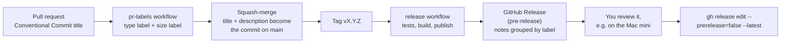

# Releasing

A release is a deliberate act on a tag. It publishes a GitHub Release with notes grouped by type, the agent for Apple Silicon, the built web UI and checksums.

## Versions
The product version is the **spec version**: `spec/0.3.0/` is release `v0.3.0`. A new spec version is a new release; a fix that needs no spec change is a patch (`v1.2.1`). Tags are `vMAJOR.MINOR.PATCH`.

## How a PR becomes a release note



So **PR titles are the release notes**. Use `feat`, `fix`, `perf`, `refactor`, `docs`, `test`, `ci` or `chore`, and `!` for a breaking change. Add the label `skip-changelog` to keep a PR out of the notes.

| Label | Release notes heading |
| --- | --- |
| `breaking` | Breaking changes |
| `feature` | Features |
| `fix` | Fixes |
| `performance` | Performance |
| `refactor` | Refactoring |
| `documentation` | Documentation |
| `test`, `ci` | Tests and CI |
| `dependencies` | Dependencies |
| anything else | Other changes |

## Cutting a release
1. Make sure `main` is green and contains what you want to ship.
2. Move the `[Unreleased]` entries in [`CHANGELOG.md`](../CHANGELOG.md) under a dated `[X.Y.Z]` heading, through a normal PR.
3. Tag the merge commit and push the tag:
   ```sh
   git switch main && git pull
   git tag -a vX.Y.Z -m "minidash X.Y.Z"
   git push origin vX.Y.Z
   ```
4. The `release` workflow runs the tests, builds the assets and publishes the release **as a pre-release**. Watch it under Actions.
5. Review the release page: grouped notes, assets and `SHA256SUMS`. Install it on the Mac mini ([deploy.md](deploy.md)) and run through the manual checks.
6. Promote it:
   ```sh
   gh release edit vX.Y.Z --prerelease=false --latest
   ```

## What is attached
| File | What it is |
| --- | --- |
| `minidash-agent-X.Y.Z-darwin-arm64` | The agent, built for Apple Silicon (no cgo, so Linux builds it). Make it executable and run it under launchd as in [deploy.md](deploy.md). |
| `minidash-web-X.Y.Z.tar.gz` | The built web UI. Serve it with any static server, or build the container from source. |
| `SHA256SUMS` | Checksums. Verify with `shasum -a 256 -c SHA256SUMS`. |

A binary downloaded in a browser may be quarantined by macOS: `xattr -d com.apple.quarantine <file>`. Files fetched with `curl` or `gh release download` are not.

## Building the assets yourself
```sh
deploy/make-release-assets.sh vX.Y.Z      # writes dist/release/
```

## If something goes wrong
- **The workflow failed:** fix forward and push a new patch tag, or delete the tag (`git push --delete origin vX.Y.Z`) and the draft release, fix, and tag again.
- **A bad release is already promoted:** run `gh release edit vX.Y.Z --prerelease` to demote it, then publish a patch.
- **A tag was pushed on a commit without the workflow** (for example an old commit): nothing publishes. Create the release by hand with `gh release create` and attach assets built by the script.
