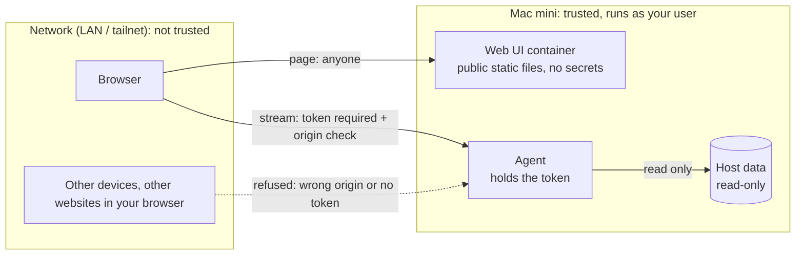

# Security

minidash is a read-only monitor for a machine on a trusted home or lab network. It is not designed to be exposed to the internet.

## What it protects
The dashboard reveals process names, container names and images, mounted shares, connected client IPs and account names, and system load. That is useful to an attacker doing reconnaissance, so the stream requires a token.

## Trust boundaries

| Boundary | Control |
| --- | --- |
| Agent stream | Token required as the first WebSocket message; constant-time comparison; 5 second auth window; close code 1008 on failure. An unauthenticated client receives nothing. |
| Cross-site WebSocket hijacking | The upgrade checks `Origin` against `MINIDASH_ORIGINS`. Other websites cannot open the socket from your browser. |
| Web UI | Serves public static files only. It holds no token and no metrics. |
| Host | The agent runs as an unprivileged user and only reads. The container client sends `GET` requests only (a test asserts it). |

## Container hardening
Read-only root filesystem, unprivileged user (uid 101), all capabilities dropped, `no-new-privileges`, no server version banner. Every response, including static assets, carries a Content-Security-Policy (`default-src 'self'`, WebSocket connections only), `X-Frame-Options: DENY`, `X-Content-Type-Options: nosniff` and `Referrer-Policy: no-referrer`.

## What is and is not collected
| Collected | Never collected |
| --- | --- |
| Process executable name, PID, owner, CPU, memory | Command-line arguments (they can hold secrets) |
| Mounted share server, share name, mount point, account name | Passwords or credentials of any kind |
| Container name, image, CPU, memory, network | Container environment variables, logs or files |
| Connected client IP and the serving process's owner | Share contents, file names, traffic contents |

SMB accounts that are opaque Apple ID service identifiers (`com.apple.idms.*`, which embed account UUIDs) are displayed as "Apple ID". Test fixtures in the repo use invented data only.

## Known limitations
Read these before deciding how to expose it.

1. **Plain HTTP and `ws://` on the LAN.** Over the LAN addresses the token and all metrics cross the network unencrypted, and anyone who can sniff your network can read them. Use the **HTTPS over Tailscale** path instead: `deploy/tailscale-https.sh on` publishes the UI and the agent stream over HTTPS to your tailnet only, with certificates Tailscale manages ([deploy.md](deploy.md#3-https-over-tailscale-optional-recommended), [ADR 0012](adr/0012-https-through-tailscale-serve.md)). Tailscale's own connections are also WireGuard-encrypted. The plain HTTP addresses remain as a fallback, so prefer the HTTPS URL and avoid the plain one on networks you do not trust.
2. **One shared token.** There are no per-user accounts and no audit trail. Rotate it if it leaks ([configuration.md](configuration.md#rotating-the-token)).
3. **No rate limiting on authentication.** A client has 5 seconds per connection and the token has 192 bits, so guessing is not practical, but repeated attempts are not throttled.
4. **`/healthz` is unauthenticated** and returns `ok`. It reveals only that the service is up.
5. **The token, layout and theme are stored in browser `localStorage`.** Layout and theme are not sensitive and are never sent anywhere. The token is. Any script running on the UI's origin could read the token. The Content-Security-Policy restricts scripts to the page's own files (including the small `theme-init.js`); inline scripts are not allowed.
6. **The agent listens on all interfaces by default.** Set `MINIDASH_ADDR=127.0.0.1:8787` if you only browse from the Mac itself.
7. **Third-party binary.** `macmon` runs as your user and is trusted to report sensor data. It is installed from Homebrew.

## Hardening checklist
- [ ] Reach it over the HTTPS Tailscale address (`deploy/tailscale-https.sh on`) rather than the plain LAN address, especially on networks with devices you do not trust.
- [ ] Never enable Tailscale Funnel for this dashboard. The script refuses it.
- [ ] Do not forward ports 8080 or 8787 on your router.
- [ ] Keep `~/.config/minidash/agent.env` at mode 600.
- [ ] Rotate the token if a device is lost or shared.
- [ ] Keep Homebrew packages (`macmon`) and the container base images current.

## Reporting a vulnerability
See [SECURITY.md](../SECURITY.md).
